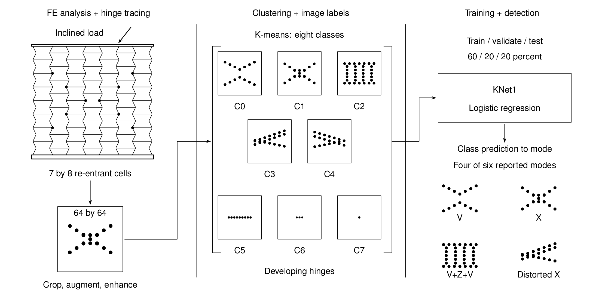

# Graphical abstract

The published KNet1 method classifies re-entrant honeycomb deformation from
plastic-hinge images using K-means labels and logistic regression.



This redraw follows the **accepted manuscript**, rather than transferring class
IDs from a recovered submission edition. It shows the paper's three stages:
finite-element analysis and plastic-hinge tracing, image clustering, then
classifier training and mode interpretation.

The 7 by 8 lattice is an indicative native drawing of the specimen described in
Figure 4, not the exact finite-element mesh. Eight alternating zigzag wall chains
and staggered horizontal ligaments replace the incorrect abutting-cell grid.
Short vertical necks are retained, and the top and bottom rails contact the walls.
Black marks sit on wall joints and denote conceptual plastic regions. The normalized image and eight class thumbnails are symbolic
hinge-field sketches informed by Table 1; they are not extracted sample images,
intensity maps, PCA coordinates or measurements. Their point counts and spacing
carry no quantitative meaning.

The accepted manuscript's assignments are retained:

| Accepted image classes | Interpretation in Table 1 |
| --- | --- |
| C0 | V mode, with separated arms. |
| C1 | X mode. |
| C2 | V+Z+V mode, with fused patches. |
| C3 and C4 | Distorted X. |
| C5, C6 and C7 | Developing hinge patterns, not three additional named modes. |

The input arrow terminates at the left grouping bracket; the right bracket
passes all eight classes to the classifier. The extraction arrow attaches to the
normalized image frame, and classifier arrows use named rectangle/text anchors.
A single inclined loading arrow terminates at the top platen.

The bracket passes all eight classes to the classifier. Class predictions are
then interpreted as deformation modes; eight image classes are not described as
eight successfully detected named mechanisms. The 60/20/20 partition is the
paper's reported training/validation/test split, not a new experiment. The four
named modes are the four of six reported in the paper. No accuracy or new result
is asserted, and the separate KNet2 HF recovery is not used as visual evidence.

## Sources and fidelity

[Published paper](https://doi.org/10.1177/20414196241281069), accepted manuscript:

- Figure 2, manuscript p. 3: physical deformation modes and hinge paths.
- Figure 3, p. 5: the three main stages and preprocessing/clustering/training flow.
- Figure 4, p. 6: the 7 by 8 re-entrant prototype and loading conditions.
- Figure 7, p. 11: eight image classes; the new illustration does not reproduce
  the plotted PCA coordinates or imply a new scatter plot.
- Results and Table 1, pp. 13–14: accepted class-to-mode interpretation.
- Training method: the reported 60/20/20 partition.

The manuscript is not distributed here. Access the article through its
[DOI](https://doi.org/10.1177/20414196241281069).
Its checksum and relevant page references are recorded in `provenance.json`.
The original publisher figures are not redistributed as standalone assets; this
new schematic is a conceptual redraw with its limitations stated above.

## Editable source and build

`deformvis.tex` is entirely native TikZ geometry and text. No generated raster,
external artwork, model prompt or paid image API is involved. The central approved
style reference guided the unshaded black-line presentation only.

The canvas is 220 by 110 mm (2:1). Labels use one 9 pt Helvetica-compatible family.
The checked PDF is vector; the grayscale PNG is 2200 by 1100 pixels. The 900 by
450 review render and compilation products stay in ignored `.local/` storage.

With TeX Live (standalone, TikZ, Helvetica), Ghostscript and Poppler installed,
run from the repository root:

```sh
mkdir -p .local/figure-build
pdflatex -no-shell-escape -halt-on-error -interaction=nonstopmode \
  -output-directory=.local/figure-build figures/deformvis/deformvis.tex
gs -q -dSAFER -dBATCH -dNOPAUSE -sDEVICE=pnggray \
  -dTextAlphaBits=4 -dGraphicsAlphaBits=4 -g2200x1100 -r254 \
  -sOutputFile=.local/figure-build/deformvis.png \
  .local/figure-build/deformvis.pdf
```

These commands rebuild a vector PDF and grayscale PNG locally. The shipped
exports additionally passed the central renderer's native font, size, colour
and page-bound checks. Scientific fidelity and arrow endpoints were reviewed
visually at full resolution and at README scale.
